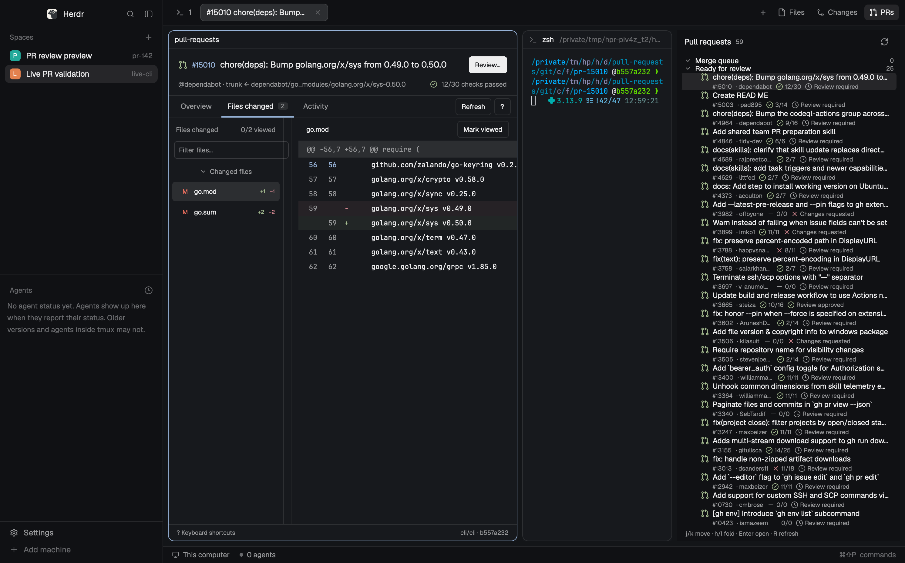

# Pull requests

Review GitHub pull requests inside Herdr. A compact PR tree sits beside Files
and Changes. Each PR opens a native review tab with its own terminal checkout.

## What you see

Herdr's existing spaces, agents, tabs and terminal appearance remain. PRs is a
third button beside Files and Changes. Its panel uses compact, foldable Merge
queue, Ready for review and Drafts groups. Rows show title, author, check progress
and GitHub's review decision. Running checks use Herdr's native spinning icon.

The review pane has a compact PR header and Overview, Files changed and Activity
navigation. The file tree sits on the left of the diff and is resizable. A real
terminal occupies the right side of the tab. Overview prioritizes checks and
approvals; description is secondary. The composer puts the comment field above
Comment, Approve and Request changes, without explanatory paragraphs.

## How it behaves

Refresh runs every 30 seconds after first opening and on Refresh or `r`.
Clicking an already-open PR focuses its exact tab. New PR tabs use isolated,
revision-pinned checkouts. New remote commits require an explicit update; user
changes and conflicting files prevent checkout updates.

Vim-style navigation and the built-in help cover files, diff lines and ranges.
Marking a file viewed folds it. The PR number opens GitHub. Copying produces
clipboard context and never executes a terminal command.

Cmd+Enter opens and focuses the review composer. Escape leaves editing;
`j/k` or `1/2/3` chooses Comment, Approve or Request changes, and `i` returns to
editing. Cmd+Enter submits; Enter inserts a newline. A second Escape closes.
Drafts survive errors. Sending and uncertain outcomes block duplicate sends.

## Built from

One personal mod root, `mods/pull-requests/`, supplies list, review and composer
roles through props and internal modules. It uses GPUI primitives, native
Markdown/input controls, Herdr theme colors, existing Herdr status SVGs and PR
lifecycle SVGs. Tab-bar and layout copies follow the installed layout's existing
Files/Changes pattern; shipped originals are left intact.

The Rust `herdr-pr` helper invokes Git/GitHub CLI with argument arrays and existing
authentication. `herdr.exec`, `writeTextFile`, `appHome`, native scoped keybindings,
clipboard and the existing `herdr-app do` commands connect it to Herdr. The latter
returns exact creation IDs for tabs and terminals. No shared app/core API grows.

Source, installation and validation are documented in [README.md](README.md).

## Watch out

This version targets local GitHub.com repositories on macOS. Git, authenticated
`gh`, the installed `herdr-app` command and Rust are required; Python 3 runs the
installer. Personal layout copies need manual reconciliation with future upstream
layout changes. GitHub's review decision is authoritative; no required-approval
denominator is invented.

Bridge output is bounded: return pages, never a successful truncated diff. Keep
review coordinates pinned to commit objects rather than a mutable checkout. A
clean checkout can still have been switched by hand; verify ownership and HEAD.
Protect ignored conflicts too. Publishing creates a pending review only after
explicit submission, records its ID, then publishes that exact review. Unknown
outcomes require reconciliation, never blind retries. GitHub provides no atomic
expected-head review condition.

## Done when

The list follows every page and shows truthful check/review states. Opening twice
focuses one tab. The diff matches its pinned commits even after checkout edits.
Dirty, switched and conflicting ignored files survive updates. Viewed files fold;
keyboard navigation, text entry, selection and clipboard work in the native app.
Double-submit and lost-response tests preserve one review attempt. Native checks,
real Git integration tests and an isolated populated-window pass succeed. A live
review-write check is reported separately and needs a concrete authorized target.
